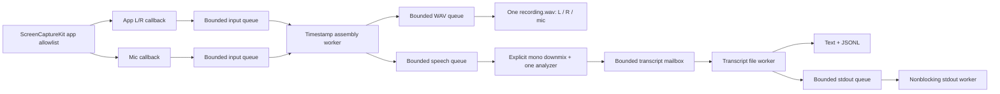

# Architecture

One Swift executable uses ScreenCaptureKit's selected-application audio and
microphone outputs, Core Audio device/process discovery, and Apple's on-device
SpeechAnalyzer/SpeechTranscriber. It has no package
dependencies or network client. Only the explicit `setup-speech` command asks
Apple's asset framework to download a model.

Before recording, `--app` resolves a case-insensitive name/bundle substring or
quoted `*`/`?` wildcard against running main applications. One match selects
automatically; ambiguity uses a numbered stdin picker with stderr prompts.
Embedded helpers are omitted. Selection binds one bundle ID and PID, which
native capture revalidates and uses in its single-application filter.
Noninteractive ambiguity fails before output creation or capture permissions.
See [app selection](adr/0004-select-app-by-name-or-pattern.md).

The short form `capture-it teams` routes to recording. Default output is a
sanitized search-term plus local timestamp in the current directory. Before
opening capture, explicit `--mic` wins; otherwise a single exposed active
input from the app's audio processes is preferred, with system-default fallback.
Input device scope and active-input status come from public Core Audio properties.
The selected UID/source/reason are logged and persisted. See
[capture defaults](adr/0005-capture-defaults-and-app-microphone.md).

`AudioQueue` is a single-producer/single-consumer atomic ring. Each native
callback copies into one bounded input ring without file I/O, resampling,
logging or model calls. One assembler consumes both input rings using
nonblocking polls. Capture is bounded best-effort, not hard-real-time or
allocation-free.

Each input ring holds at most 256 buffers. The assembler normalizes app stereo
and mono microphone input to 48 kHz, maps capture timestamps into a four-second
sample ring, and emits discrete three-channel blocks 0.5 seconds behind the
host clock. Missing-source intervals become silence. Buffers arriving after
that deadline, backward timestamps and excessive clock gaps are explicit
recording failures. Transcript/file time starts at the first emitted sample.

The assembler produces one immutable audio stream with independent WAV and
speech consumers, each with a 256-buffer ring. The speech worker downmixes
0.25*left + 0.25*right + 0.5*microphone before converting to the analyzer's
chosen format. Saved-file replay uses the same downmix and one analyzer.
Analyzer timestamps advance by converted output frames, preventing resampling
rounding from overlapping adjacent input timestamps.
The analyzer input has a 128-buffer limit. Transcript and stdout queues each
hold at most 512 segments; transcript text is not retained in an unbounded
in-memory array.

The single PCM16 WAV uses WAVE_FORMAT_EXTENSIBLE with discrete channels,
periodic header checkpoints and an explicit RIFF size guard. No rollover
occurs. The manifest declares app-left/app-right/microphone order and input
sample counts. Different player downmix rules do not affect the explicit
recognition downmix. v0.1 separate-file replay is rejected without changing
old files.

Transcript publication uses a short control-plane mutex for transcript
publication; no I/O occurs under it. The file worker writes and syncs text and
JSONL, then offers identical text bytes to stdout's ring. Stdout uses nonblocking
writes and poll with a two-second deadline. A stalled reader is explicitly
reported and disconnected; files and capture continue. The descriptor's flags
are restored when its worker finishes. Stdout flags apply to the inherited
file description while this worker is active.

The recording lifecycle is starting → recording → stopping → complete/failed.
Transcription has independent disabled/unavailable/running/complete/incomplete/interrupted
states. Every failure is attached to the session. Model, queue and transcript
failures do not invalidate successfully saved audio.

Shutdown stops native producers first, drains input queues through the assembler,
and closes the WAV writer. Audio completion is persisted before waiting for speech.
The first Ctrl-C enters draining; speech can finish without a fixed deadline.
The second interrupt skips recognition and transcript-output waits after audio
closure. Signal-source coalescing counts toward this escalation. Duration and
error stops also enter draining, so a subsequent interrupt skips speech.
Transcript files drain next, then stdout, with interruptible control-plane joins.
An interrupted session retains written text and marks transcription interrupted;
the final summary does not claim completeness. See [shutdown](adr/0006-two-stage-interrupt-shutdown.md).

The native stream lives only for the capture lifecycle. Its app allowlist
never broadens to capture all system audio. No video output is attached or
saved, although ScreenCaptureKit requires a display and screen/audio permission.
Native stop is bounded to three seconds; failures are reported in the manifest.
Abrupt termination cannot guarantee
that the latest file or native resource has finalized; persistent files expose
the last checkpoint rather than claiming success.

Explicit `--hook` executables run after audio closure and the transcription
attempt. Optional `make setup` installs FluidAudio beside the CLI and enables
automatic first-party labeling in that same hook path; `--no-fluid` skips it.
A versioned JSON handoff includes absolute WAV and optional text paths.
Each hook has a private output/log directory, process group and timeout. Hook
stdout never participates in the transcript tee; failures preserve capture and
continue the chain, while interruption cancels the group and skips remaining
hooks. The standalone `hooks` command can retry on saved artifacts. See
[hook contract](hooks.md) and [decision](adr/0007-explicit-post-session-hooks.md).
Provider-specific behavior and speaker enrichment stay outside the core.
See [installed FluidAudio selection](adr/0010-installed-fluid-hook.md).

A separate serial Accessibility worker reads only the selected PID's window
titles, bounded to eight windows and 150 ms per message. It updates an optional
meeting snapshot every two seconds without waiting on audio workers or during
shutdown. A unique non-generic title is an unverified candidate; --title is user
provided. Doctor reports trust; setup-accessibility requests it explicitly.
The snapshot travels in session/hook metadata. See
[title provenance](adr/0008-meeting-title-provenance.md).

Decisions: [Use independent bounded workers](adr/0001-native-concurrent-cli.md),
[use ScreenCaptureKit for native capture](adr/0002-screencapturekit-capture.md),
and [store one multichannel WAV](adr/0003-single-multichannel-wav.md).
